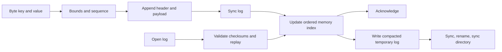

# DurableStore

**Byte storage, with an explicit recovery contract.**

A small Rust key-value engine for understanding persistent state: synchronized
writes, atomic batches, checksummed replay, an exclusive writer and atomic log
compaction. Use the library or the JSON CLI; no server or third-party Rust
dependencies are required.

[Run a complete example](#try-it) · [Atomic batches](#atomic-batches) · [Persistence contract](#persistence-contract) · [Inside the engine](#inside-the-engine)

## Three changes, one durable transition

A queued job becomes complete, its pending entry disappears, and its result is
recorded in one batch. The included example opens a fresh CLI process for every
operation, then compacts and reopens the store:

| Before | After one three-operation batch |
| --- | --- |
| `job:42 = queued` | `job:42 = complete` |
| `pending:42 = artifact.txt` | Removed |
| No result | `result:42 = artifact.txt` |

```json
{
  "operations_in_transition": 3,
  "reopened_and_compacted": true,
  "external_message_sent": false
}
```

This excerpt comes from the [recorded local run](docs/presentation/atomic-batch-session.json).
[Reproduce it](docs/presentation/README.md) with the existing
[`batch_demo.py`](scripts/batch_demo.py). It is a local state transition, not an
external message delivery guarantee.

Recovery admits a complete batch or none of it. An unacknowledged batch may
already have persisted. The [eight-boundary process-crash record](docs/crash-demo.json)
and [crash demonstration](#crash-recovery-checks) explore that distinction;
process termination does not establish hardware power-loss safety.

## Try it

Requirements: Rust 1.89 or newer, Linux or macOS, and a local filesystem. No third-party Rust dependencies, server, account, or network access at runtime.

```sh
git clone https://github.com/nazeeh111/DurableStore.git
cd DurableStore
cargo build --release --locked
mkdir demo-store
./target/release/durablestore demo-store init
./target/release/durablestore demo-store put 68656c6c6f 776f726c64
./target/release/durablestore demo-store get 68656c6c6f
# {"found":true,"value_hex":"776f726c64"} means hello -> world
./target/release/durablestore demo-store inspect
./target/release/durablestore demo-store health
./target/release/durablestore demo-store compact
```

The sequence creates a store, writes `hello → world`, reads it back and compacts
the log. The `get` value is hexadecimal for `world`. Both `inspect` and `health`
scan without repairing the log; a normal open can repair an incomplete tail.
Use `durablestore --help` for JSON usage and `--version` for the source version.

This checkout identifies itself as `0.2.1-dev.0`. The [v0.2.0 release](https://github.com/nazeeh111/DurableStore/releases/tag/v0.2.0)
is historical and does not contain the new `health` operation.

Keys and values use hexadecimal in the CLI, allowing arbitrary bytes. `""` represents empty bytes. `list` returns keys in byte-sorted order. `delete <key-hex>` appends a tombstone, including for absent keys. `get` exits with code **3** for a missing key; operational/input errors exit **2** with a JSON error on stderr. Successful commands emit JSON on stdout and exit **0**. Only `init` creates a database; the directory must already exist. The library supports values larger than common shell argument limits.

Every hexadecimal argument also accepts `@FILE` to read hex from a file, or `@-`
to read standard input. This includes keys, values, scan prefixes and cursors, so
legal large inputs do not need to fit the operating system's argument limit.
Files contain hex digits, optionally followed by one LF or CRLF; an empty file
represents empty bytes. Reads are bounded by twice the decoded key/value limit
plus the final line ending, and input errors are rejected before opening the
store. At most one argument per command may read stdin. Batch files keep their
existing tab-separated format; `@FILE` applies to CLI hex arguments only.

```rust
use durablestore::Store;

fn save_result(directory: &std::path::Path) -> durablestore::Result<()> {
    let mut store = Store::open(directory)?;
    store.put(b"experiment", b"complete")?; // sync succeeds before returning
    assert_eq!(store.get(b"experiment"), Some(b"complete".as_slice()));
    store.delete(b"experiment")?;
    store.compact()?;
    Ok(())
}
```

## Prefix scans and pages

Use `scan` to read one key namespace without serializing the entire live index:

```sh
./target/release/durablestore demo-store scan 70656e64696e673a 100
# prefix is pending:; response has entries and next_after_hex
./target/release/durablestore demo-store scan 70656e64696e673a 100 <next_after_hex>
```

Entries are byte-sorted. Pass the returned `next_after_hex` as the exclusive cursor
until it is `null`. An empty string is a valid cursor for the empty key; it does
not mean completion. An empty prefix (`""`) scans all keys. Limits are integers
from 1 to 1,000. A page also stops before exceeding 64 MiB of key/value hexadecimal
data, with small JSON framing overhead. Each legal single entry fits. The cursor
must start with the requested prefix and need not still exist in the store.
Invalid arguments are rejected before opening the store.

For a large continuation cursor, save the non-null `next_after_hex` string as
`cursor.hex` (without JSON quotes), then use:

```sh
./target/release/durablestore demo-store scan "" 100 @cursor.hex
```

Use the same prefix for every page; a large prefix can likewise use `@prefix.hex`.
An empty cursor file resumes after the empty key, while `null` means stop.

The library provides `store.scan_prefix(prefix, after)` as a borrowing iterator
that seeks into the existing ordered index without collecting all matches.
`after: None` starts at the prefix; `Some(key)` excludes that key and all earlier
keys. Callers can use `.take(limit)` for their own page size. An empty prefix
matches all keys, including empty and arbitrary binary keys.

Each CLI page opens the store again. Writes between pages can change the results:
a new key at or before the cursor will not appear, and deleted keys disappear.
This is not a snapshot transaction. Startup still replays the whole log into RAM,
and normal open can repair an incomplete tail, just like `get` and `list`.
The existing lock, storage format and durability contract apply.

## Atomic batches

Use a batch when related keys must change together. For example, mark a queued job complete while removing its pending entry and adding its result. A batch uses one checksummed record and one synchronization; recovery exposes all its changes or none.

```rust
use durablestore::{Operation, Store};

fn complete_job(store: &mut Store) -> durablestore::Result<()> {
    store.write_batch(&[
        Operation::Put(b"job:42", b"complete"),
        Operation::Delete(b"pending:42"),
        Operation::Put(b"result:42", b"artifact.txt"),
    ])
}
```

The CLI reads a file or standard input. Fields are separated by literal tabs; keys and values are hexadecimal. Empty fields represent empty bytes. Input is validated before opening the store.

```sh
printf 'put\t6a6f623a3432\t636f6d706c657465\ndelete\t70656e64696e673a3432\n' > changes.tsv
./target/release/durablestore demo-store batch changes.tsv
# {"ok":true,"durable":true,"operations":2}
```

To apply a batch only if a key still has the value you observed, append
`if <key-hex> <value-hex>`. For example, the following transition requires
`job:42` to still contain `queued`:

```sh
./target/release/durablestore demo-store batch changes.tsv if 6a6f623a3432 717565756564
```

Use `absent` to require a missing key, or `""` to require a present key
holding zero bytes. The comparison and all writes share the exclusive store
handle. A mismatch appends no record, prints
`{"ok":false,"reason":"condition_failed"}` and exits 3. A busy lock is an
operational error (exit 2). Opening the store can still repair an incomplete
log tail before evaluating the guard. Both guard arguments accept the same bounded
`@FILE` or `@-` inputs as `get` and `put`. At most one input can use stdin.
The comparison observes the current bytes. To detect a change away and back,
use a fresh version token for each transition and update it in the same batch.

Run `python3 scripts/batch_demo.py target/release/durablestore` for a complete outbox-state example using disposable local data. It sends no messages.

`batch -` reads standard input. Each line is `put<TAB>key<TAB>value` or `delete<TAB>key`. LF and CRLF are accepted; blank lines, extra fields and empty files are rejected. At most 1,024 operations and 32 MiB of encoded batch payload are allowed. Per-key and per-value limits still apply. Operations run in listed order, including repeated keys. An empty library batch does nothing; it still rejects a poisoned handle.

Old single-operation logs remain readable. Older DurableStore binaries reject batch records; keep the new binary with stores that use batches. Compaction writes the resulting live state as ordinary put records. This is atomic grouped writing, without rollback commands or concurrent transactions. A complete batch may survive a crash even if the caller did not receive acknowledgement.

## Persistence contract

| Event | Behavior |
| --- | --- |
| `put` / `delete` / `write_batch` returns `Ok` | Complete record was written and `File::sync_all` succeeded. |
| Process dies before acknowledgement | That operation may be absent or present. Earlier acknowledged state survives under the supported filesystem contract. |
| Incomplete terminal record | Opening discards only its incomplete bytes, synchronizes the repair, and reports the count in `Stats::tail_bytes`. |
| Full record has bad checksum, bad lengths, or wrong sequence | Opening fails without modifying `data.wal`. |
| Append or compaction fails | Further writes are rejected on that handle. Drop and reopen to determine the persisted state. Reads on the old handle remain its last acknowledged in-memory state. |
| Another handle owns the store | Open and inspection fail immediately instead of waiting indefinitely. |
| Compaction is interrupted | Recovery uses the original log or the atomically replaced compacted log. Both represent the same live state. |

`health` takes the same exclusive lock and validates the whole available log without reconstructing live keys. It reports `good`, `truncated`, `corrupt` or `sequence_error`, the validated record count and byte prefix, total bytes, and the first incomplete or invalid record offset. Exit 0 means good, 3 means an incomplete or corrupt log, and 2 means an I/O, lock or invocation failure. Bytes beyond an invalid record have not been validated; a truncated suffix follows the same rule as recovery. It never repairs or creates a store. Memory is bounded by one record (up to the 32 MiB batch limit plus operation metadata), not total live data. The lock excludes cooperating store handles, not programs that modify files directly. CRC is not authentication.

`inspect` acquires the lock and scans without creating files or repairing a tail. Ordinary opens can repair a tail. All commands require exclusive access; this intentionally avoids a second concurrent-reader consistency contract. Never delete or replace `LOCK`, or rename/delete the store directory, while any handle is open.

Spawning a child that immediately executes a new program is supported. Do not fork and then use or drop an inherited `Store` in the child: its lock refers to the same operating-system object as the parent, and unlocking either copy releases that shared lock. Open a fresh store only after executing the child program.

A checksum detects accidental damage, not hostile changes. An incomplete suffix caused by a failed append is indistinguishable from some kinds of external truncation; recovery cannot reconstruct bytes that a separate program destroyed. The process-crash tests do **not** demonstrate power-loss safety on every controller or filesystem. Durability depends on the filesystem and hardware honoring synchronization. macOS `sync_all` is not a claim of hardware-cache flush via `F_FULLFSYNC`.

## Inside the engine



- **Ordered index:** a `BTreeMap` owns live keys and values. Reads are in memory; this is not an on-disk B-tree.
- **Write-ahead log:** versioned, little-endian, length-bounded records with separate header and payload CRC-32 checksums. Bounds are checked before allocating payload memory.
- **Compaction:** sorted live entries replace the log atomically. The lock file keeps a stable inode across replacement. Sequence numbers are local to a log and restart during compaction.
- **Initialization:** a synchronized temporary file is renamed into place. Existing partial or invalid file headers are rejected rather than treated as an empty store.

See [the binary format](docs/format.md) and [design decisions](docs/design.md). The entire implementation uses safe Rust and the standard library.

## Crash-recovery checks

```sh
cargo test --locked
cargo test --locked --all-features
cargo build --locked --features fault-injection
python3 scripts/crash_demo.py target/debug/durablestore
```

The optional feature makes specifically named boundaries terminate with exit code 86, bypassing Rust destructors. The demonstration checks acknowledged values and deletions after each termination, then confirms the reopened store accepts another write. The default binary ignores those environment variables. **Do not enable `fault-injection` for real data.**

Tests also compare seeded operation sequences against an independent `BTreeMap` model, flip every individual byte of a fixture, cut its final record at every offset, interrupt initialization and tail recovery, reject oversized inputs, exercise lock contention across processes, and inject I/O errors that must poison a handle. These tests cover the listed failure cases.

## Benchmark

```sh
cargo run --release --locked --example benchmark -- ./bench-store 1000 > benchmark.json
```

The destination must not already exist. The benchmark writes each 256-byte value twice with a sync per operation, reads warm in-memory keys, deletes a quarter of keys, compacts, and verifies every remaining key after reopening. JSON includes p50/p95/p99 latency, operation counts, compiler/OS/CPU details, log sizes, and compaction/reopen time. The directory is retained for inspection. Read timings measure the memory index, not disk lookup. Short microbenchmarks are sensitive to timer overhead, cache state, filesystem, and competing work; no cross-engine performance claim is made.

[Measured v0.1.0 single-operation baseline](docs/benchmark.json) and [verification record](docs/verification.md). The retained benchmark predates atomic batches; it is not a v0.2.0 batch measurement.

## Supported scope

Maximum key: **1 MiB**. Maximum value: **16 MiB**. Empty keys and values work. Startup is linear in log bytes and holds all live data in RAM; compaction needs temporary disk space for the full live set. There is no interactive transaction, SQL, replication, encryption, TTL, concurrent reader process, background compaction, or network-filesystem support. Data directories must be trusted: this is not a hardened service that accepts arbitrary paths from hostile clients. Compaction removes historical versions, so preserve an offline copy if you need a forensic history.

MIT licensed; copyright nazeeh111.
